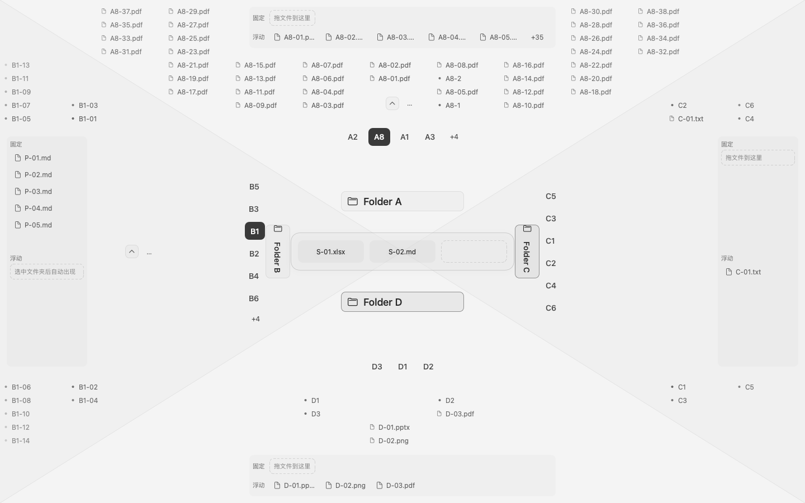
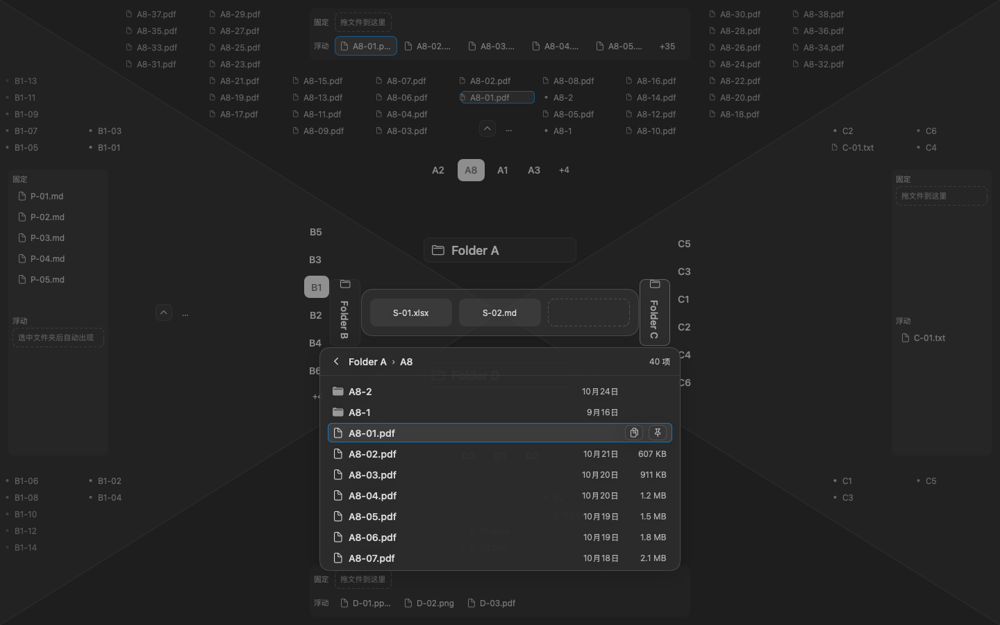

<div align="center">

# Quadrant Launcher

**按一下快捷键，四个常用文件夹铺满屏幕。三次点击内找到文件，复制路径或直接拖走。**

A full-screen, four-quadrant file launcher for the macOS menu bar.




</div>

## Why

我每天要从一大堆文件里找出某一个，再把它交给别的地方：复制路径贴进 AI 对话、拖进聊天窗口、拖进编辑器。

- **Finder 太慢、太宽。** 它显示整个系统，而我只关心固定的几个文件夹：下载、桌面、文档、笔记。文件在深层时要一层层点下去，「知道有这个文件、甚至知道路径，也很难找到」。
- **菜单栏的「最近文件」小工具太窄。** 只能看最新的十来个文件，看不到目录结构。

Quadrant Launcher 只做一件事：把你最常用的四个文件夹同时摊在屏幕上，让常用的东西永远在眼前，找到后一步交出去。

## Features

- **四象限全屏面板**：上下左右各放一个常驻文件夹（例如 Downloads、Desktop、Documents、笔记）。唤起后不用移动鼠标，直接看到四个文件夹的前三层。
- **越常用越靠前、越亮**：分支目录按使用频率排序；第三层文件夹以「星点」显示，用得越多越亮，深层的使用也会累计到上层。
- **透镜（Lens）钻到深层**：点一个星点就在透镜里继续往下找，最深到第七层。下次再点同一个星点，直接回到上次停留的位置。
- **直接打字过滤**：记得名字时打开面板就打字，匹配项高亮，结果列在透镜里。
- **一步交出文件**：复制完整路径后面板自动关闭；拖动时面板变透明、鼠标穿透，不挡住目标应用。
- **文件架**：每个象限边缘有「固定位」放长期常用的文件，「浮动位」自动显示当前文件夹里最常用的文件。
- **暂存区**：中心最多暂存 3 个文件，作为中转。Finder 里 ⌘C 的文件也能 ⌘V 放进来。
- **象限之间复制**：在一个象限 ⌘C 文件，到另一个象限的文件夹 ⌘V，复制进去，原文件不动。
- **置顶与隐藏**：重要但点得不多的文件夹可以置顶；用不上的分支目录可以隐藏。
- **全键盘操作**：⌘ + 方向键在象限之间跳，方向键在区域内移动；快捷键可以用配置文件改。
- **只读、本地**：不移动、不删除、不重命名你的文件。使用记录只存在本机的 SQLite 里。

<div align="center">



<sub>深色模式下的透镜：在 Folder A › A8 里往下找，选中的文件可以一步复制路径或固定到文件架。截图用示例数据渲染，文件夹和文件名都是代号。</sub>

</div>

## Getting started

需要 macOS 15 及以上，以及 Swift 6 工具链（Xcode 或 Command Line Tools）。

```bash
git clone https://github.com/asd316/quadrant-launcher.git
cd quadrant-launcher
```

然后选一种方式运行：

| 方式 | 做法 |
|---|---|
| 直接试用 | 在 Finder 里双击 `Launch Quadrant.command`。它会编译、启动，并直接打开面板。 |
| 装成 App | 运行 `Scripts/package-dmg.sh`，把 `dist/` 里 DMG 中的 `Quadrant Launcher.app` 拖进 `/Applications`。 |

DMG 用的是 ad-hoc 签名，没有经过公证。第一次打开时如果 macOS 拦截，请在 Finder 里右键 App → 打开。

第一次启动时，四个象限默认使用 `~/Downloads`、`~/Desktop`、`~/Documents` 和 `~/Documents/Notes`（存在才会用）。点菜单栏的 ▦ 图标可以换成任意文件夹，也可以让某个象限空着。

## Usage

| 做什么 | 怎么做 |
|---|---|
| 唤起 / 关闭面板 | 点菜单栏 ▦ 图标；或用 Raycast 绑全局快捷键，见 [`Scripts/Raycast`](Scripts/Raycast/README.md) |
| 在象限之间跳 | ⌘ ↑ ↓ ← → |
| 在区域内选择 | ↑ ↓，→ 进入文件夹，← 返回 |
| 确认选中项 | ↩：分支目录 → 聚焦，星点 → 打开透镜，文件 → 复制路径并关闭面板 |
| 用默认应用打开 | ⌘↩，或双击 |
| 放进暂存区 | ⌘S |
| 固定 / 置顶 | ⌘P：文件放进固定位，文件夹置顶 |
| 过滤 | 打开面板后直接打字，Esc 清除 |

面板快捷键可以在 `~/Library/Application Support/QuadrantLauncher/shortcuts.json` 里改：

```json
{ "version": 1, "bindings": { "stash": "⌘S", "pin": "⌘P" } }
```

## How it works

```
QuadrantUI ──▶ QuadrantCore ◀── QuadrantSystem
 SwiftUI 视图     全部业务规则        文件扫描 · FSEvents
 AppKit 面板      纯函数，无副作用     SQLite · 剪贴板
```

- **QuadrantCore** 是一组同步纯函数：`reduce(状态, 意图, 时间) → (新状态, 副作用)`，`project(...) → 每个象限要显示什么`。排序、截断、权重全在这里，测试只需要喂数据。
- **QuadrantSystem** 实现 Core 定义的端口：扫描文件夹、监听变化、持久化使用记录（GRDB）。对磁盘只读。
- **QuadrantUI** 只负责画 Core 给的结果。
- 依赖方向由 `Package.swift` 的 target 依赖强制。

## Development

```bash
swift build                     # 编译
Scripts/test.sh                 # 运行全部测试（swift-testing）
Scripts/check-escape-hatches.sh # 检查没写理由的并发逃生口
```

只装了 Command Line Tools 时，`swift test` 找不到 Testing.framework，请用 `Scripts/test.sh`，它会补上框架路径。

## Status

这是一个自用工具，正在日常使用中打磨。目前没有：

- 内置的全局快捷键（需要完整 Xcode 编译 KeyboardShortcuts，暂时用 Raycast 代替）
- 设置界面（象限在菜单栏里设，快捷键用配置文件改）
- 文件内容搜索、预览、移动、删除、重命名（有意不做）

欢迎提 Issue 交流想法。

## License

[MIT](LICENSE) © asd316
